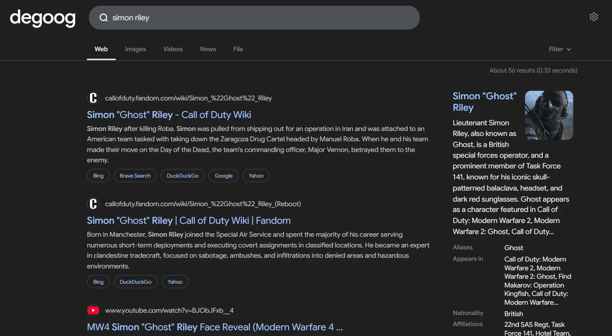

# Fandom

Shows a knowledge panel for pages on the [Fandom](https://www.fandom.com) wikis you add, like degoog's Wikipedia panel does for Wikipedia. Add a wiki such as `https://callofduty.fandom.com`. When a search names one of its pages, a card shows the page's image, opening text, a few facts from its infobox and a link to the full page, with the wiki's name and icon. Click the image to open it full size in a new tab. Redirects count, so `simon riley` finds `Simon "Ghost" Riley` and `mw2` finds `Call of Duty: Modern Warfare 2`.

    

## Triggers

These examples assume the Call of Duty Wiki with the keywords `cod, call of duty`, and the Star Wars wiki (Wookieepedia).

| Query | What you get |
| --- | --- |
| `simon riley` | A page whose title or redirect is the whole search, from the first wiki that has one. |
| `ak47` | Case, spaces and punctuation don't have to match, so this finds `AK-47`. |
| `mw2` | Redirects are followed to the page they point at. |
| `cod ak-47` | A keyword at the start looks on that wiki only. |
| `ak-47 cod wiki` | A keyword at the end works too, optionally followed by `wiki` or `fandom`. |
| `luke skywalker fandom` | `fandom` or `wiki` at the end looks on every wiki, even with bare matching off. |

No card is shown for disambiguation pages, such as the Call of Duty Wiki's `Ghost`, or for redirects to categories and other non-article pages. Searches with search operators (`site:`), web addresses, `!bangs` or no letters, searches longer than eight words, and a keyword on its own with `wiki` or `fandom` (`cod wiki`) are never looked up. When keywords on two wikis both match, the longer one wins, so `star wars` beats `star`.

With bare matching on, everyday words that happen to be page titles also show a card. For example, `london` matches the Call of Duty Wiki's London page. The card sits beside the results and never replaces them. If it gets in the way, turn bare matching off and use keywords.

## Settings

- **Wikis**: the wikis to search, highest priority first. Enter the address of a wiki on fandom.com. Language wikis such as `https://naruto.fandom.com/es` work too. Add up to ten.
- **Keywords** (for each wiki): optional, comma separated. A search that starts or ends with one only looks on that wiki. The wiki's subdomain, such as `callofduty`, always works as a keyword.
- **Match page titles on their own**: show a card when the whole search is a page title. When it's off, a search needs a keyword, or `wiki` or `fandom` at the end.
- **Show image**: show the page's main image.
- **Show facts**: list rows from the page's infobox.
- **Number of facts**: how many infobox rows to show, from 1 to 10.
- **Position**: the knowledge panel by default. The sidebar slots, at a glance and above results are also available.

## Privacy

Nothing is looked up until you add a wiki. After that, every search that passes the quick check above is sent to the `api.php` of each wiki you added. A search with a keyword goes only to that keyword's wiki: the words after the keyword, and with bare matching on, the whole search too. Each lookup asks for exact titles and redirects first, and makes a prefix search only when that finds nothing. The page that is shown costs one more request, for its opening section. At most 120 lookups that aren't cached go out per minute, for all visitors together, so a flood of searches can't flood Fandom. Past that, no card is shown until the minute is up. The requests come from your degoog server through its outgoing connection, so proxy and transport settings apply and visitors' IP addresses are never shared. Results are cached for six hours, and searches with no match for an hour.

The page image and wiki icon come from Fandom's image server (`static.wikia.nocookie.net`) and load through degoog's image proxy, so visitors never contact Fandom unless they open the page link. Clicking the image opens the full-size file through the same proxy.

degoog's built-in Wikipedia panel also uses the knowledge panel slot, so both cards can appear for the same search.

## No-JS mode

The panel renders the same on the `/nojs` page. The plugin has no client script.
