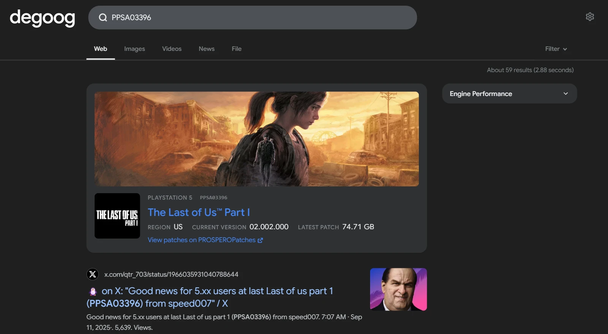

# Prospero Patches

Looks up PlayStation 5 (Prospero) title IDs on [PROSPEROPatches](https://prosperopatches.com). Search for a title ID such as `PPSA01628` and the panel shows the game's name, icon and background art with its logo when it has one, its region, current version and the size of the latest patch, with a link to the title's page on PROSPEROPatches. Click the icon, background or logo to open the full image in a new tab.

    

## Triggers

| Query | What you get |
| --- | --- |
| `PPSA01628` | The title with that ID. |
| `PPSA-01628` | The same, with a hyphen after the prefix. |
| `ppsa01628` | Upper and lower case both work. |

The whole query has to be the title ID, so searches such as `PPSA01628 patch` stay normal searches. Only PS5 `PPSA` IDs are recognised, since those are what PROSPEROPatches lists. No panel is shown when PROSPEROPatches doesn't know the title.

## Settings

- **Show icon**: show the game's icon next to its name.
- **Show background art**: show the game's background art as a banner above the title.
- **Show logo**: show the game's logo on the background art. None of the titles checked so far have one on PROSPEROPatches, so it rarely appears. It needs the background art turned on.
- **Show details**: list the region, current version and size of the latest patch.
- **Position**: at a glance by default. Above results and the sidebar slots are also available.

## Privacy

Only the title ID is sent to PROSPEROPatches (`https://prosperopatches.com/api/lookup?titleid=…`), never the rest of the query, and only when the whole query is a title ID. The request goes through degoog's outgoing connection, so proxy and transport settings apply and the visitor's IP address is not shared. Titles are cached for six hours, and unknown IDs for an hour.

The icon, background art and logo are fetched from `cdn.prosperopatches.com` by your degoog server and served to the browser from the plugin's own route, so visitors never contact PROSPEROPatches. Only art URLs on that CDN are fetched.

## No-JS mode

The panel renders the same on the `/nojs` page. The plugin has no client script.
