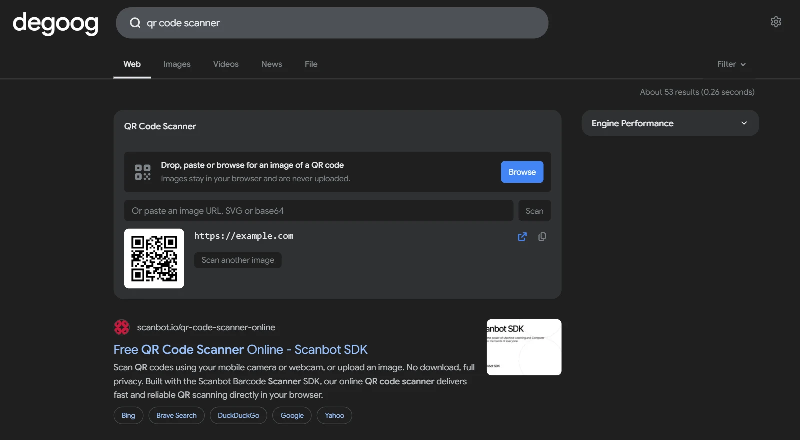

# QR Code Scanner

Reads QR codes straight from the search page. Search for something like `qr code reader` and a scanner panel appears. Click it to browse for an image (phones also offer the camera), paste a screenshot, drag an image in, or paste an image URL. The decoded text shows up in the panel, with a copy button and, for web links, a button to open them. You can also go straight to a result with the `!qrscan` bang and an image URL.

    

## Triggers

| Query | What you get |
| --- | --- |
| `qr`, `qr code` | The scanner panel. Can be turned off in the settings, since these are also common searches. |
| `qr scanner`, `qr code reader`, `scan qr code`, `decode qr` | The scanner panel, always. |
| `read qr code from image`, `qr code reader online` | Small words around the keywords are fine. |
| `qr-code scannen`, `lire code qr`, `leggi codice qr` | German, French and Italian work too. |
| `qr https://example.com/code.png` | Scans that image right away. |
| `scan qr https://example.com/qr?id=42` | A link without an image file name needs a word such as “scan” or “read”. |
| `!qrscan https://example.com/code.png` | The bang: scans the image in place of the results. Also `!qrread` and `!qrdecode`. SVG markup and base64 image data work in place of the URL. |
| `!qrscan` | The bang without a URL opens an empty scanner. |

Every word of the query has to fit, so `qr code generator`, `qr code for wifi`, `what is a qr code` or `free qr code` stay normal searches. So does `qr code https://example.com`, which asks for a code for that site rather than to scan it.

The bang isn't `!qr`, because degoog's official QR code generator already uses `!qr` and `!qrcode`. If you turn on natural language for that generator, its first-word match also catches queries that start with `qr`, such as `qr scanner`. Start them with another word (`scan qr`, `read qr code`) or use `!qrscan`.

## Reading an image

- **Browse**: click the panel, or focus it and press Enter.
- **Paste**: copy an image or a screenshot and press Ctrl+V (⌘V) while the panel has focus. When the page has only one scanner and nothing else is focused, a pasted image goes to it too. Pasting an image URL works the same way, or paste it into the URL field.
- **Drag and drop**: drop an image file, or an image dragged from another tab, onto the panel.
- **Image data as text**: paste or drop SVG markup (`<svg …>…</svg>`, with or without an XML declaration), a `data:image/…` URL, or raw base64 of a PNG, JPEG or GIF without the `data:` prefix. Line breaks in base64 are fine. When nothing else on the page has focus, these go to the scanner too. The same text also works after `qr` in the search bar or after `!qrscan`. It is decoded locally and never fetched or uploaded.

The panel uses the browser's built-in barcode reader where there is one (Chrome on Android, macOS and ChromeOS). Elsewhere it loads [jsQR](https://github.com/cozmo/jsQR) (Apache-2.0, ~250 KB) from your degoog server the first time it is needed. If an image holds several codes, the built-in reader lists up to five of them.

## Settings

- **Show for a plain “qr”**: show the scanner when the whole search is just `qr` or `qr code`. Off means a word such as “scanner” or “read”, or an image URL, is required.
- **Scan image links**: load images from links through degoog’s image proxy. Turn it off on a public instance if you don’t want visitors to use the proxy for arbitrary images. Files, pasted images, SVG and base64 keep working. The slot and the `!qrscan` command each have this setting.
- **Position**: at a glance by default. Above results and the sidebar slots are also available.

The slot (natural language) and the `!qrscan` command are listed separately in degoog's settings and can be turned on and off on their own.

## Privacy

Images you browse for, paste or drop are decoded in your browser and never uploaded. Image URLs are fetched by your degoog server through its own image proxy, so the site hosting the image sees your server, not your browser. That proxy refuses private and local addresses, only passes images and stops at 25 MB. Links pasted into the panel are signed by the plugin only with a token issued with that panel, valid for an hour, so the plugin doesn't open the proxy to other sites. Keep in mind that anyone who can search can still scan a link with `!qrscan`; turn off **Scan image links** if that matters for your instance. No other network requests are made, and nothing is stored.

## No-JS mode

The scanner needs JavaScript, so it is not shown on the `/nojs` page.
