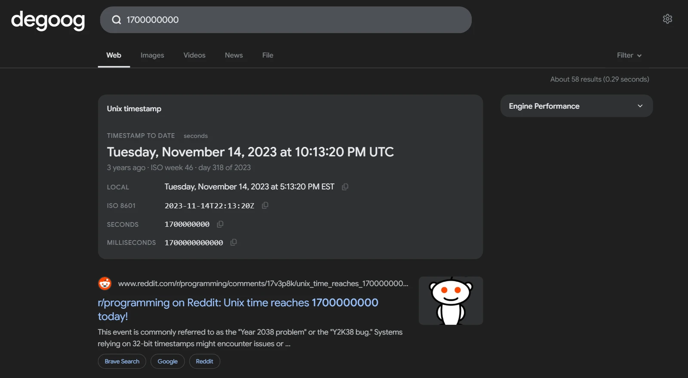

# Timestamp

Converts Unix timestamps into human readable dates and dates back into timestamps, straight from the search bar. Think [epochconverter.com](https://www.epochconverter.com/), without leaving degoog.

The panel shows the UTC date, your local date (rendered in your browser, in your own time zone), the ISO 8601 form, the value in seconds and milliseconds, how long ago or far away it is, plus the ISO week and day of the year. Every value has a copy button.

    

## Triggers

No bang needed. The slot appears when the query looks like one of these:

| Query | What you get |
| --- | --- |
| `1700000000` | A bare number with 9 or more digits is read as a timestamp. 12+ digits are milliseconds, 15+ microseconds, 18+ nanoseconds. |
| `@1700000000` | The `date -d @…` form, always seconds. |
| `1700000000000 ms`, `1700000000µs` | A 9+ digit number with a unit works even when bare numbers are turned off. Shorter numbers with only a unit, such as `500 ms`, are left alone because they are usually durations. |
| `epoch 86400`, `epoch millis 1700000000`, `unix time 1700000000` | A keyword plus a number of any length. A unit word (`s`, `ms`, `us`/`µs`, `ns`, or spelled out) overrides the digit-count guess. Looser keywords such as `unix` or `to date` need a 9+ digit number or a unit, so searches like `unix 101` stay normal searches. |
| `2024-01-15`, `2024-01-15T10:30:00Z` | ISO 8601 dates become timestamps. |
| `15 jan 2024 10:30 utc timestamp`, `epoch for March 3, 2021`, `13.07.2025 to unix time` | A keyword plus a date. English month names, `YYYY-MM-DD`, `DD.MM.YYYY` and `MM/DD/YYYY` are understood. |
| `unix timestamp`, `epoch now`, `current unix time` | A live counter of the current timestamp. |

Dates without a time zone are read as UTC and the panel says so. Add `Z`, `UTC` or an offset such as `+02:00` to change that.

Keywords: `timestamp`, `epoch`, `epoch time`, `unix time`, `unix timestamp`, `unixtime`, `posix time`, `time_t`, plus `zeitstempel`, `unixzeit`, `horodatage` and `marca de tiempo`.

## Settings

- **Convert bare numbers**: show the panel for a bare 9+ digit number. Off means a keyword is required.
- **Convert bare dates**: show the panel for a bare ISO 8601 date. Off means a keyword is required.
- **Clock format**: 12-hour, 24-hour or follow the locale.
- **Extra time zones**: comma-separated IANA zones, such as `America/New_York, Europe/Berlin`, listed below UTC and local time.
- **Position**: at a glance by default. Above results and the sidebar slots are also available.

## Privacy

Everything is computed on your degoog server and in your browser. No network requests are made and nothing leaves the instance.

## No-JS mode

The panel also renders on the `/nojs` page. Local time and copy buttons need JavaScript and are left out there.
