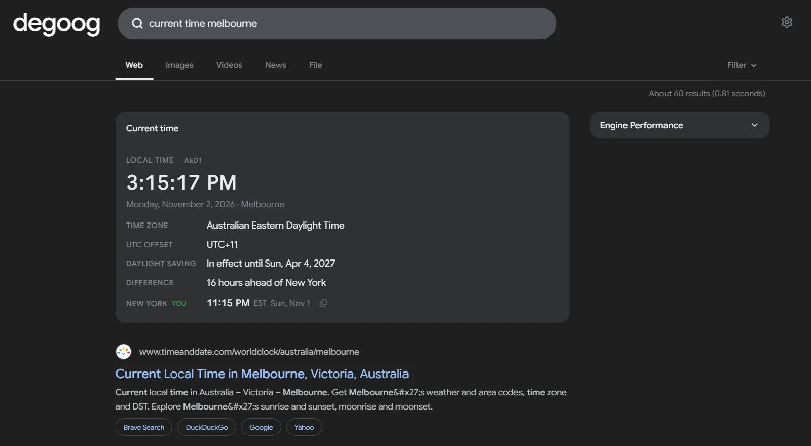

# Time zone

Answers time zone questions straight from the search bar, without a bang. Ask for the current time anywhere, convert a time between zones, compare two zones, or find out when the clocks change next.

The panel shows a live clock, the zone's full name, abbreviation and UTC offset, whether daylight saving time is in effect, and how far ahead or behind your own time it is. Conversions take each zone's daylight saving rules into account on the date in question, and say so when a time is skipped or repeated by a clock change. Every time has a copy button.

    

## Triggers

| Query | What you get |
| --- | --- |
| `current time melbourne`, `what time is it in tokyo`, `time in new york`, `london time now` | The current time in a city, country, US state or zone. |
| `melbourne time`, `tokyo timezone` | The same for two-word queries. This can be turned off. |
| `current time foster city`, `current time springfield il`, `what time is it in paris, texas` | Smaller places are looked up online. Add a state, province or country to pick the right one. |
| `springfield il time to foster city ca time`, `5pm springfield il to paris tx` | Compares or converts between two looked-up places. Name the state or country, or put `time` after each place. |
| `current time ET`, `eastern time`, `what is cet`, `utc` | Abbreviations and zone names work too. |
| `what time is it in the usa`, `time in london and tokyo` | Several zones at once. Countries that span several zones list them all. |
| `what time zone is dubai in`, `what is my time zone` | The zone's name, offset and current time. |
| `what time is it`, `local time` | Your own current time. |
| `5pm ET to PT`, `17:00 london to new york`, `9am utc+5:30 to pst` | Converts a time. Use `to`, `in`, `→` or `->` between zones. |
| `5pm ET to PT, CET and tokyo` | Converts into several zones at once. |
| `5pm ET tomorrow to PT`, `5pm ET monday to PT`, `5pm et to pt nov 8 2026` | Converts a time on another day, using the daylight saving rules of that date. |
| `5pm ET`, `5pm in tokyo`, `5pm to tokyo` | Converts to or from your own time. |
| `ET to PT`, `time difference between london and tokyo`, `how many hours ahead is tokyo` | The difference between two zones right now, and when it changes next. |
| `when does daylight savings go into effect`, `when does the time change`, `when does dst end` | The next clock change in your zone, the one after it, and whether daylight saving time is in effect now. |
| `when do the clocks go back in the uk`, `dst start date germany`, `daylight saving melbourne` | The same for another place. |
| `daylight savings 2027`, `spring forward 2027` | Every clock change in a given year. |
| `is it daylight savings time right now`, `does japan observe dst` | Whether daylight saving time is in effect. |

Times can be written as `5pm`, `5:30 pm`, `5 p.m.`, `17:00`, `17h30`, `noon` or `midnight`, and `1700z` or `17:00z` for UTC. Dates can be `today`, `tomorrow`, a weekday, `nov 8`, `8 november 2026` or `2026-11-08`. A weekday means the next one, or today if the time has not passed yet.

Ambiguous abbreviations pick the most common meaning and add a note. `CST` is US Central Time, with a note when China Standard Time differs. `IST` is India Standard Time, with a note mentioning Israel and Ireland. A season-specific abbreviation such as `EST` is read as the whole zone, so `5pm EST` on a date in July means 5pm Eastern Daylight Time, and the panel says so. Two-letter abbreviations such as `ET` and `PT` only count next to a time or another zone, so searches like `ct scan` or `pt cruiser` stay normal searches. City pairs such as `london to paris` need a time or the word `time`, so travel searches are left alone.

## Settings

- **Home time zone**: the zone used when a question names none, such as `5pm ET` or `when does the time change`. Accepts an IANA zone such as `America/New_York`, a city or an abbreviation. Blank uses the server's own zone.
- **Clock format**: 12-hour, 24-hour or follow the visitor's language.
- **Show seconds**: show seconds on the live clock.
- **Answer short queries**: answer two-word queries such as `tokyo time`. Off means a fuller question such as `time in tokyo` is needed.
- **Look up other places online**: find places that are not built in, such as `current time foster city`. Off keeps every lookup on the server.
- **Use the visitor's time zone**: let the browser replace the home time zone with the visitor's own and add a row with their local time.
- **Position**: at a glance by default. Above results and the sidebar slots are also available.

## Privacy

Times are computed on your degoog server and in your browser, from the time zone data built into the JavaScript runtime. About 850 cities, countries, states and zone names are built in and never leave the server.

Other places are looked up with the [Open-Meteo geocoding API](https://open-meteo.com/en/docs/geocoding-api), whose data comes from [GeoNames](https://www.geonames.org/) under CC BY 4.0. Only the place name is sent, plus a country code when the query names one, never the rest of the query. The request goes through degoog's outgoing connection, so proxy and transport settings apply and the visitor's IP address is not shared. Answers are cached for a day. These lookups only happen for clear time questions such as `current time <place>`, and you can turn them off in the settings.

The visitor's time zone is read in the browser and never sent to the server.

## No-JS mode

The panel also renders on the `/nojs` page, using the home time zone. The clock does not tick there, and copy buttons and the visitor's local time are left out.
